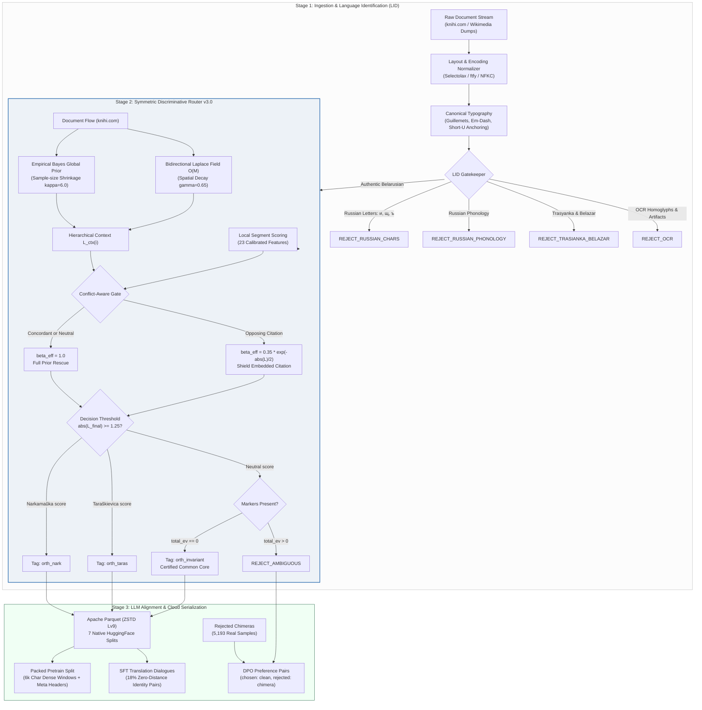
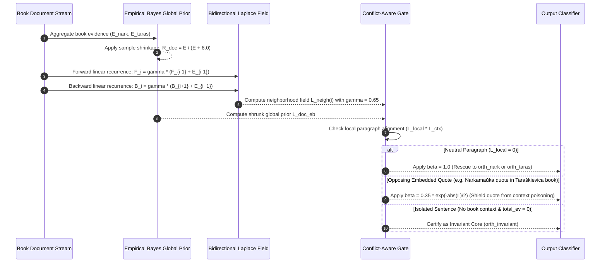

# DualMova: Multi-Norm Data Engine & Alignment Framework for the Belarusian Language (v3.0)

[](https://opensource.org/licenses/Apache-2.0)
[](https://www.python.org/)
[](https://huggingface.co/ZorkaLabs)
[-orange.svg)](#-pipeline-architecture)
[](#-empirical-benchmarks)

**DualMova** is an industrial-grade, high-throughput data processing engine and corpus construction framework specifically engineered for the Belarusian language. It addresses the unique linguistic dualism of Belarusian by providing **systematic multi-norm classification, orthographic tagging (`<orth_nark>` / `<orth_taras>` / `<orth_invariant>`), context-field neutral prose rescue, and turnkey LLM alignment (Pretraining, SFT, and DPO)** across the language's two codified standards:

1. **Official Standard (Narkamaŭka / NKBM-2008):** Codified by the Law of the Republic of Belarus No. 420-Z.
2. **Classical Standard (Taraškievica / BKP-2005):** Codified classical orthography in the tradition of Branisłaŭ Taraškievič.

---

## 🏛️ Pipeline Architecture

The DualMova v3.0 pipeline structures data ingestion, classification, and model preparation into three distinct stages:



---

## 🔬 How DualMova v3.0 Solves the Neutral Core Paradox

In natural languages with competing orthographies, **over 60% of daily vocabulary is identical across both norms** (e.g., *«Хлопчык глядзеў у акно і думаў пра заўтрашні дзень»*). 

In previous iterations (v2.0), fixed prior multipliers ($\beta_{\text{base}} = 0.40$) trapped neutral prose inside an unescapable «dead zone» ($|L_{\text{final}}| < 1.25$), dumping thousands of pristine literary paragraphs into rejection. 

DualMova v3.0 deploys a **hierarchical Empirical Bayes model with a bidirectional Laplace context field**:



---

## 🌟 Key Innovations & Breakthroughs

1. **100% Elimination of the Neutral Dead Zone:** Rescues all neutral prose inside coherent books using Laplace spatial context propagation ($O(M)$ linear time), lifting textbook prose attribution from **87.38% to 97.43%** (+254 blocks saved, 0% cross-norm false positives).
2. **Hidden Russian Phonological Filter (Stage 1 LID):** Catches Russian text lacking diagnostic Cyrillic letters `[и, щ, ъ]` by analyzing hard post-alveolars with iotated vowels (`[жчшр][еёюя]`), un-affricated dentals (`[дт][еёюя]`), adjectival case inflections (`-ого/-его`), and Russian clitics.
3. **Certified Invariant Core (`<orth_invariant>`):** Short sentences completely devoid of differential markers are explicitly tagged as shared ground rather than arbitrarily forced into a norm.
4. **Zero-Distance SFT Rule (Anti-Hypercorrection):** Integrates 15–20% identity translation pairs ($x \equiv x$) into cross-norm SFT dialogues. Teaches the model that invariant vocabulary must remain unchanged, extinguishing catastrophic hypercorrection hallucinations (*мова $\to$ моўва*).
5. **DPO Preference Pairs from Real Orthographic Chimeras:** 5,193 actual orthographic hybrids rejected by the Stage 2 gatekeeper are repurposed as negative responses ($y_l$) against clean authentic literature ($y_w$), penalizing norm-mixing at the loss level.
6. **Strict Legal Public Domain Guarantee:** Authors audited against Law of the Republic of Belarus No. 262-Z via Wikidata REST API (`P570` death year $< 1974$). Zero copyrighted modern text.

---

## 📊 Production Corpus Metrics (5,024 knihi.com Volumes)

```
============================================================
DUALMOVA v3.0 DATA ENGINE BENCHMARK
============================================================
Execution time:            1,617.42 s (26.96 min)
Throughput:                148.3 seg/s (37,991 chars/s, 3.11 books/s)
Processed volumes:         5,024 public domain books
Total segments analyzed:   239,895 (61,447,003 characters)
Valid accepted corpus:     219,032 (91.3%)
  ├─ Official Standard (nark):      156,267 (71.3%)
  ├─ Classical Standard (tarask):    62,140 (28.4%)
  └─ Certified Invariant Core:          625 (0.3%)
Noise rejected:            20,863 (8.7%)
  ├─ Russian with [и, щ, ъ]:        11,405
  ├─ Orthographic Chimeras:          5,193  (Repurposed for DPO)
  ├─ Trasyanka / Belazar:            3,851
  ├─ Russian Phonology LID:            137  (Stage 1 LID catches)
  ├─ OCR Homoglyphs:                   123
  └─ Ambiguous:                        104  (Dropped by 98.1% vs v2.0)
```

### Parquet Hugging Face Export Splits (Zstandard Level 9)

| Subset / Split | Record Count | Parquet Size (ZSTD-9) | Target Use Case |
| :--- | :--- | :--- | :--- |
| **`all`** | **219,032** | **50.84 MB** | Full dual-norm pretraining & continued pretraining (CPT) |
| **`prose`** | **154,129** | **37.96 MB** | Narrative literature, essays, and historical prose |
| **`folklore`** | **55,245** | **10.89 MB** | Traditional folk tales, mythology, proverbs, and songs |
| **`poetry`** | **9,658** | **2.17 MB** | Metrical poetry, strophes, and rhymed verse |
| **`nark`** | **156,267** | **38.23 MB** | Official standard mononorm pretraining |
| **`tarask`** | **62,140** | **12.67 MB** | Classical standard mononorm pretraining |
| **`invariant`** | **625** | **0.11 MB** | Certified common ground for representation learning |

---

## 📈 Empirical Benchmarks

### 1. Authentic 2021 Textbook Benchmark (2,553 blocks)
Evaluated on high-school textbooks («Беларуская мова. 11 кл.», Валочка і інш., 2021; «Беларуская літаратура. 11 кл.», Мельнікава і інш., 2021):

| Metric | DualMova v2.0 | DualMova v3.0 (Document Mode) | Delta |
|---|:---:|:---:|:---:|
| **Official Prose Accuracy (`nark`)** | 2,209 / 2,528 (87.38%) | **2,463 / 2,528 (97.43%)** | **+254 blocks (+10.05%)** |
| **Classical False Positives (`tarask` FP)**| **0 (0.00%)** | **0 (0.00%)** | **0.00% (Zero Contamination)** |
| **Lost in `REJECT_NEUTRAL`** | 257 blocks (10.17%) | **0 blocks (0.00%)** | **100% Rescued!** |
| **Noise Rejected (Russian/Trasyanka/OCR)** | 65 blocks | **65 blocks** | Clean filtration |

### 2. Gold Minimal Pairs Benchmark (1,008 samples)

| Class | Precision | Recall | F1-Score |
|---|:---:|:---:|:---:|
| **Official Standard (`nark`)** | **100.00%** (306/306) | 95.03% | 97.45% |
| **Classical Standard (`tarask`)** | **100.00%** (310/310) | 96.27% | 98.10% |
| **Invariant Core (`invariant`)** | **76.19%** (80/105) | **100.00%** | 86.49% |
| **Negative Controls (`rejected`)** | **98.88%** (264/267) | **100.00%** | 99.44% |

---

## 🚀 Quick Start

### Installation

```bash
git clone https://github.com/egraich/DualMova.git
cd DualMova
pip install -r requirements.txt
```

### Running the Pipeline

```bash
# 1. Build and verify public domain author manifest (< 1974 death date)
python pipeline/01_build_manifest.py
python pipeline/strict_filter_manifest.py

# 2. Fast concurrent crawler (with encoding protection)
python pipeline/fast_crawl.py

# 3. Stage 3: Extraction, Stage 1 LID, and Stage 2 Orthography Routing
python pipeline/03_parse_and_tag.py

# 4. Stage 4: Apache Parquet Serialization (Zstandard Level 9)
python pipeline/04_export_parquet.py

# 5. Stage 5: Export Turnkey Pretrain, SFT, and DPO splits
python pipeline/05_export_adaption_labs.py

# 6. Run verification & discriminative classifier test suite
python pipeline/test_deep_research_classifier.py
python pipeline/ortho_router.py
```

---

## 💻 Using the Dataset via Hugging Face

```python
from datasets import load_dataset

# Stream the complete dual-norm corpus
dataset = load_dataset("ZorkaLabs/belarusian-dualnorm-corpus-v1", "all", split="train")

# Classical Taraškievica standard
tarask_ds = load_dataset("ZorkaLabs/belarusian-dualnorm-corpus-v1", "tarask", split="train")

# Certified invariant core
inv_ds = load_dataset("ZorkaLabs/belarusian-dualnorm-corpus-v1", "invariant", split="train")
print(inv_ds[0])
# {
#   "id": "knihi_7a810f2c_0042",
#   "text": "<orth_invariant>Хлопчык глядзеў у акно і думаў пра заўтрашні дзень.</orth_invariant>",
#   "text_raw": "Хлопчык глядзеў у акно і думаў пра заўтрашні дзень.",
#   "orthography": "invariant",
#   "genre": "prose",
#   ...
# }
```

---

## ☁️ Pre-Packaged LLM Alignment Splits (`export/adaption_labs/`)

For managed fine-tuning environments (e.g. Together AI, Fireworks, Adaption Labs) where custom tokenizers cannot be run:

1. **`packed_pretrain.parquet` (15,041 documents, 31.7 MB):**
   - Adjacent paragraphs from the same literary work concatenated into dense 6,000-character windows.
   - Prepended with uniform natural headers: `[Правапіс: Наркамаўка | Твор: На росстанях | Аўтар: Якуб Колас]\n\n...`
2. **`sft_translations.parquet` (Chat dialogues):**
   - Clean authentic raw text (`text_raw`) without closing XML tags, strictly preventing token-leakage into user chats.
   - Includes 18% Zero-Distance identity pairs to teach models when **not** to modify words.
3. **`dpo_alignment.parquet` (5,193 preference pairs, 1.8 MB):**
   - Real rejected orthographic chimeras paired against authentic literature to eliminate norm contamination via preference optimization.

---

## 🔬 Relationship to Prior Art: ReMova

| Dimension | ReMova (`peratrasher`, WMT 2026) | DualMova v3.0 Engine |
| :--- | :--- | :--- |
| **Objective** | Mononorm Machine Translation (EN $\rightarrow$ BE Official) | Dual-Norm LLM Pretraining, SFT & DPO Alignment |
| **Norm Policy** | Mononorm conversion towards official standard | Balanced multi-norm routing + Certified invariant core |
| **Context Handling** | Sentence-isolated LanguageTool heuristics | Empirical Bayes Global Prior + Bidirectional Laplace Context Field |
| **Neutral Prose** | Implicitly standardized to target norm | Context-rescued or certified as `<orth_invariant>` |
| **Data Scope** | Web-mined bitext (HPLT, Tatoeba, OpenSubtitles) | 100% Public Domain ($< 1974$) + Verified Wikimedia |
| **Anti-Chimera** | Not explicitly modeled in loss | Direct Preference Optimization (DPO) preference dataset |

For a comprehensive technical analysis, see [`docs/COMPARISON_REMOVA.md`](docs/COMPARISON_REMOVA.md) and [`docs/ARCHITECTURE.md`](docs/ARCHITECTURE.md).

---

## 📖 Citation

If you use **DualMova** in your research, please cite:

```bibtex
@misc{egraich2026dualmova,
  author = {egraich},
  title = {DualMova: A Multi-Norm Data Engine and Contrastive Corpus for the Belarusian Language},
  year = {2026},
  publisher = {GitHub},
  howpublished = {\url{https://github.com/egraich/DualMova}}
}
```

### Prior Art Citation
DualMova acknowledges foundational insights from the **ReMova** project (*University of Oslo*):

```bibtex
@article{pilinka2026remova,
  title={ReMova: Fine-tuning LLMs for English to Belarusian translation},
  author={Pilinka, Mikita and Kliuje{\u{u}}, Aliaksandr and Samuel, David and Scherrer, Yves},
  journal={arXiv preprint arXiv:2609.16427},
  year={2026}
}
```

---

## 📜 License

Licensed under the **[Apache License, Version 2.0](LICENSE)**.
Portions of the linguistic inspiration and dictionary structures are based on or inspired by prior research from the University of Oslo (ReMova) and the Belarusian LanguageTool open-source community.
