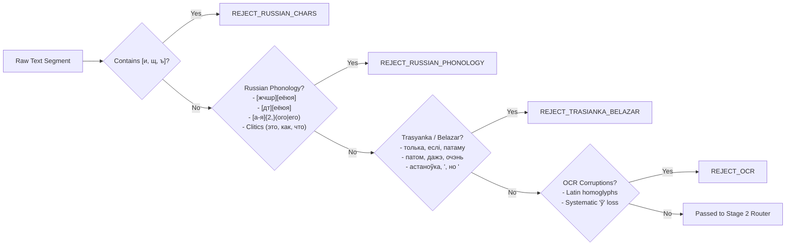
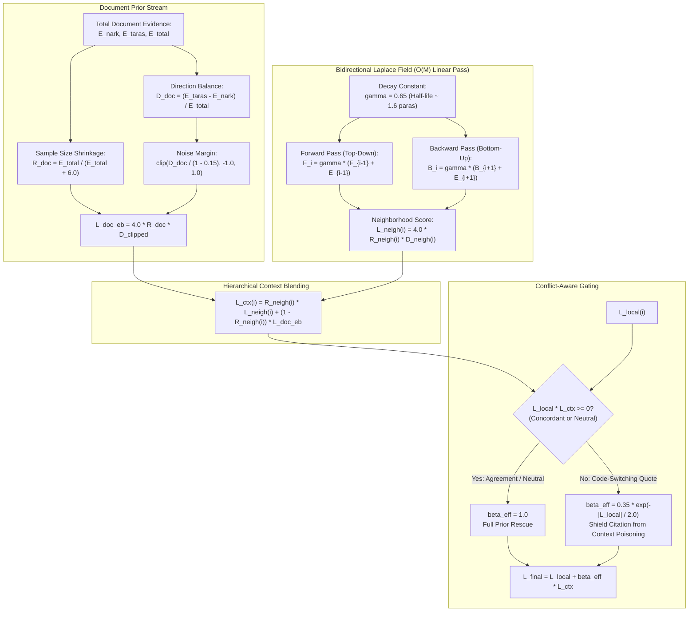
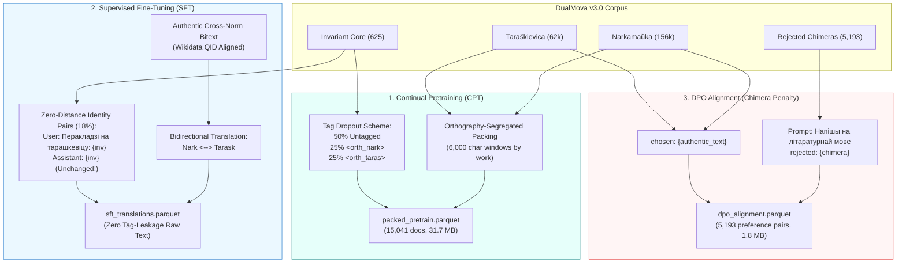

# DualMova Technical Architecture & Pipeline Specification (v3.0)

## 1. Executive Summary & Problem Formulation

**DualMova** is an industrial-grade data processing engine and corpus construction framework specifically engineered for the **Belarusian language**. It addresses the core foundational challenge of Belarusian in modern Natural Language Processing (NLP) and Large Language Model (LLM) training: **codified linguistic dual-norm orthography** (Official Standard / Narkamaŭka / NKBM-2008 vs. Classical Standard / Taraškievica / BKP-2005).

Traditional web-mined corpora (mC4, OSCAR, HPLT, MADLAD-400) indiscriminately blend both orthographies. Furthermore, they are heavily polluted by machine translation artifacts (*Belazar*), uncurated OCR errors, and cross-lingual Russian/Trasyanka interference. When language models (e.g., LLaMA, Gemma, Mistral) are trained on uncurated mixtures, they suffer from **representation collapse**: they produce orthographic chimeras, randomly mixing incompatible inflectional morphemes and phonetic markers within a single sentence (e.g., writing *«сьвяткаванне»* or *«разьвіццё»*).

DualMova solves this by structuring the ingestion process into a **three-stage pipeline with a symmetric discriminative Bayesian router**, preserving both standards in authentic fidelity, rescuing neutral prose via document context fields, and generating specialized splits for Continual Pretraining (CPT), Supervised Fine-Tuning (SFT), and Direct Preference Optimization (DPO).

---

## 2. High-Level Architecture

```mermaid
flowchart TD
    subgraph S1["Stage 1: Ingestion & Language Identification (LID)"]
        Raw["Raw Document Stream<br/>(knihi.com / Wikimedia Dumps)"] --> Parse["HTML / Wiki Parser<br/>(Selectolax / XML Stream)"]
        Parse --> Typo["Canonical Typography & NFKC<br/>(«Quotes», Em-Dash, Short-U Anchoring)"]
        Typo --> LID{"Stage 1 Filters"}
        LID -->|Russian Letters<br/>[и, щ, ъ]| RejRus["REJECT_RUSSIAN_CHARS"]
        LID -->|Russian Phonology<br/>(Hard C + Iotated, -ого/-его)| RejPhon["REJECT_RUSSIAN_PHONOLOGY"]
        LID -->|Trasyanka / Belazar<br/>(толька, еслі, астаноўка)| RejTras["REJECT_TRASIANKA_BELAZAR"]
        LID -->|OCR Artifacts<br/>(Latin Homoglyphs, Lost ў)| RejOCR["REJECT_OCR"]
        LID -->|Valid Authentic Belarusian| S2["Stage 2 Entry"]
    end

    subgraph S2["Stage 2: Symmetric Discriminative Router v3.0"]
        S2 --> Feat["Extract 23 Normative Features<br/>(Morphology, Sibilants, Loans, Proclitics)"]
        Feat --> LocalScore["Compute Local Score L_local"]
        
        DocCtx["Full Book Paragraphs"] --> EB["Empirical Bayes Global Prior<br/>L_doc_eb with Sample Shrinkage"]
        DocCtx --> Laplace["Bidirectional Laplace Field<br/>O(M) Forward/Backward L_neigh(i)"]
        EB & Laplace --> CtxScore["Combined Context L_ctx(i)"]
        
        LocalScore & CtxScore --> Gate{"Conflict-Aware Gate"}
        Gate -->|Concordant / Neutral<br/>L_local * L_ctx >= 0| Eff1["L_final = L_local + 1.0 * L_ctx"]
        Gate -->|Code-Switching Citation<br/>L_local * L_ctx < 0| Eff2["L_final = L_local + beta_conflict * L_ctx"]
        
        Eff1 & Eff2 --> Decision{"Routing Decision<br/>|L_final| >= 1.25?"}
        Decision -->|L_final <= -1.25| TagNark["Tag &lt;orth_nark&gt;"]
        Decision -->|L_final >= +1.25| TagTaras["Tag &lt;orth_taras&gt;"]
        Decision -->|Neutral |L_final| < 1.25| InvariantCheck{"Markers Present?<br/>total_ev == 0"}
        InvariantCheck -->|Yes: total_ev == 0| TagInv["Tag &lt;orth_invariant&gt;<br/>Certified Invariant Core"]
        InvariantCheck -->|No: Weak Conflict| RejAmb["REJECT_AMBIGUOUS"]
    end

    subgraph S3["Stage 3: LLM Alignment & Cloud Serialization"]
        TagNark & TagTaras & TagInv --> Parquet["Stage 4: Parquet Serialization<br/>(Zstandard Level 9, 7 Splits)"]
        Parquet --> CPT["Packed Pretrain Split<br/>(6k Char Dense Windows + Meta Headers)"]
        Parquet --> SFT["SFT Translation Split<br/>(Zero-Distance Identity Pairs 18%)"]
        RejAmb & RejChim["Rejected Chimeras<br/>(5,193 real samples)"] --> DPO["DPO Preference Pairs<br/>(chosen: authentic, rejected: chimera)"]
    end

    style S1 fill:#f9f9f9,stroke:#666,stroke-width:1px
    style S2 fill:#eef6ff,stroke:#2b6cb0,stroke-width:2px
    style S3 fill:#f0fff4,stroke:#2f855a,stroke-width:1px
```

---

## 3. Stage 1: Ingestion & Language Identification (LID)

### 3.1. Public Domain Guarantee & Author Forensics
All ingested literary works from `knihi.com` undergo legal verification under the Law of the Republic of Belarus No. 262-Z (effective 19.11.2024, 70-year post-mortem rule):
$$\text{Eligible for Public Domain} \iff \text{Year of Death} < 1974$$
Folklore, mythological texts, and statutory legal acts are non-copyrightable by statutory definition (Civil Code Art. 980, Law No. 262-Z Art. 7). Modern/living authors are strictly excluded via Wikidata entity resolution (`P570` death date).

### 3.2. Structural Extraction & Layout Parsing
1. **High-Speed HTML Parsing:** Utilizes `selectolax` (Modest engine) with a fallback to `BeautifulSoup4`.
2. **Genre-Aware Separation:**
   - **Poetry:** Detected via container semantics (`div.poem`, `pre`, rhythmic stanza formatting). Short lines ($< 120$ characters) are preserved as distinct strophes.
   - **Prose:** Paragraphs (`<p>`) are coalesced using a running length threshold ($\ge 120$ chars, $\le 2500$ chars) to prevent fragmented fragments while respecting narrative sentence boundaries.
3. **Boilerplate Stripping:** Navigational elements, table of contents, book headers, and publication colophons are regex-purged.

### 3.3. Stage 1 LID Pre-Filtering
Before orthography routing, raw text must pass Stage 1 Language Identification to purge non-Belarusian content:



1. **Russian Alphabet Filter (`re_russian_chars`):**
   Explicit exclusion of Russian characters non-existent in Belarusian: `[и, щ, ъ, И, Щ, Ъ]`.
2. **Hidden Russian Phonological Filter (`re_russian_phonology`):**
   *Addresses the blind spot where Russian sentences lack `[и, щ, ъ]`* (e.g. *«Государство должно уважать права каждого человека в нашей стране»*).
   - **Hard Post-Alveolars with Iotated Vowels:** In Belarusian, `[ж, ч, ш, р]` are inherently hard; they can never be followed by `[е, ё, ю, я]`. Matches `\b[а-яёіўґ']*[жчшр][еёюя]`.
   - **Un-affricated Dentals:** In Belarusian, dental stops undergo affrication (*дзеканне / цеканне*). Occurrences of `[дт][еёюя]` (e.g. *дело, тело, где*) are invalid in Belarusian.
   - **Genitive Case Inflections:** Masculine/neuter Russian adjectival endings `-ого/-его` (e.g. *каждого, нового, синего*) are phonologically absent in Belarusian, where adjectives strictly terminate in `-ага/-яга` (*кожнага, новага, сіняга*).
   - **Frequent Lexical Clitics:** Detects Russian particles and pronouns when appearing in un-affricated environments (*это, как, что, даже, если, когда, только, почему*).
3. **Trasyanka & Machine Translation Filter (`re_trasianka`):**
   Purges creolized forms originating from legacy MT systems (*Belazar*) or colloquial interference: *толька, еслі, патаму, патом, дажэ, очэнь, кагда, всё, сейчас, астаноўка*, and the colloquial conjunction `, но `.

---

## 4. Stage 2: Symmetric Discriminative Router (v3.0)

### 4.1. Morphonological Principles of the 23 Features
The router evaluates 23 calibrated normative features (11 Narkamaŭka, 12 Taraškievica):

| Index | Feature Key | Standard | Weight | Description & Morphological Basis |
|:---:|---|:---:|:---:|---|
| 1 | `tarask_palatal_cluster` | Taraškievica | +2.5 | Soft sign in assimilated palatal clusters (`сьв`, `зьм`, `сьн`, `цьв`, `дзьв`, `сьц`, `сьл`) outside the 7 closed NKBM-2008 categories. |
| 2 | `tarask_soft_long` | Taraškievica | +2.4 | Soft geminate sibilants and affricates with `ь`: *жыцьцё, вясельле, насяньне, калосьсе, судзьдзя*. |
| 3 | `tarask_prefix_soft_sign` | Taraškievica | +2.3 | Prefixes on `з-` written with soft sign before soft consonants: *зьняць, зьявіцца, бязьлітасны, празьмерны*. |
| 4 | `tarask_loan_hard_sibilant` | Taraškievica | +2.2 | Retention of hard dental sibilants in loan words: *сыстэма, сымбаль, сэктар, клясыка*. |
| 5 | `tarask_loan_soft_l` | Taraškievica | +2.0 | Soft European `л` in western borrowings: *плян, фільёзофія, лягічны, парлямэнт*. |
| 6 | `tarask_lex_markers` | Taraškievica | +2.0 | Codified lexical and toponymic markers: *Менск, Гародня, амбасада, эўрапейскі, унівэрсытэт*. |
| 7 | `tarask_nia_biaz` | Taraškievica | +1.8 | Pre-stressed proclitics `ня` and `бяз`: *ня быў, бяз нас, ня ведаў*. |
| 8 | `tarask_loan_initial_f` | Taraškievica | +1.8 | Greek borrowings with `т/хв` instead of `ф`: *катэдра, арытмэтыка, міт, Хведар*. |
| 9 | `tarask_morph_endings` | Taraškievica | +1.8 | Genitive masculine nouns in `-у/-ю`: *гораду, заводу, інстытуту*. |
| 10 | `tarask_noun_plural_ia` | Taraškievica | +1.7 | Neuter nominative/accusative plural in `-і/-ы`: *пасяджэньні, пытаньні*. |
| 11 | `tarask_fem_gen_adj` | Taraškievica | +1.6 | Feminine genitive adjectival ending `-ае/-яе`: *вялікае краіны, роднае мовы*. |
| 12 | `tarask_wordlist_hit` | Taraškievica | +0.6 | Membership in the 1.14M certified Taraškievica wordlist. |
| 13 | `nark_unmarked_assimilation`| Narkamaŭka | -2.2 | Unmarked phonetic assimilation in sibilant clusters: *свет, снег, змена, цвік, радасць*. |
| 14 | `nark_hard_long` | Narkamaŭka | -2.4 | Hard gemination without soft sign: *жыццё, вяселле, насенне, калоссе, суддзя*. |
| 15 | `nark_prefix_apostrophe` | Narkamaŭka | -2.2 | Prefixes on `з-` written with apostrophe: *з'явіцца, з'ехаць, без'я Pontus, уз'яднанне*. *(Corrected in v3.0: prefixes `аб-`, `пад-`, `ад-`, `над-` are shared and not penalized).* |
| 16 | `nark_loan_forms` | Narkamaŭka | -1.8 | Official loan word phonetics: *сістэма, план, сектар, класіка, логіка*. |
| 17 | `nark_lex_markers` | Narkamaŭka | -2.0 | Official toponymic and lexical variants: *Мінск, Гродна, пасольства, еўрапейскі, універсітэт*. |
| 18 | `nark_morph_endings` | Narkamaŭka | -1.8 | Genitive masculine nouns in `-а/-я`: *горада, завода, інстытута*. |
| 19 | `nark_loan_f` | Narkamaŭka | -1.8 | Greek borrowings with `ф`: *кафедра, арыфметыка, міф, Фёдар*. |
| 20 | `nark_nie_biez_stressed` | Narkamaŭka | -1.6 | Canonical initial-stress proclitics `не` and `без`: *не быў, без нас, не мог*. |
| 21 | `nark_noun_plural_ia` | Narkamaŭka | -1.7 | Neuter plural ending `-і`: *пасяджэнні, пытанні*. |
| 22 | `nark_fem_gen_adj` | Narkamaŭka | -1.6 | Feminine genitive adjectival ending `-ай/-яй`: *вялікай краіны, роднай мовы*. |
| 23 | `nark_jakanie_exceptions` | Narkamaŭka | -1.8 | Exceptions to jakanie: *герой, медаль, тэатр, се Graph*. *(Corrected in v3.0: `дэпутат` and `калектыў` removed as they are identical in BKP-2005).* |

---

## 5. The Neutral Core & Context Field Mathematics

### 5.1. Mathematical Defect of v2.0 («The 0.40 Trap»)
In DualMova v2.0, document context was incorporated via:
$$L_{\text{final}} = L_{\text{local}} + 0.40 \cdot \exp\left(-\frac{|L_{\text{local}}|}{3.0}\right) \cdot L_{\text{doc}}$$
For a neutral paragraph ($L_{\text{local}} = 0$):
$$L_{\text{final}} = 0.40 \cdot L_{\text{doc}}$$
Because the decision threshold required $|L_{\text{final}}| \ge 1.25$, saving a neutral paragraph required:
$$|L_{\text{doc}}| \ge \frac{1.25}{0.40} = 3.125 \implies \text{Document Purity } > 95.8\% \quad (\text{Ratio } > 22.76 : 1)$$
Any realistic book containing short chapters or a single foreign citation reduced $|L_{\text{doc}}|$ to $2.5 - 2.9$, causing all neutral paragraphs to fall into $|L_{\text{final}}| \in [1.00, 1.16] < 1.25$, where they were dumped into `REJECT_NEUTRAL_NO_CONTEXT` (257 blocks lost in 11th-grade textbooks alone).

### 5.2. Architecture v3.0: Empirical Bayes & Bidirectional Laplace Field



#### 1. Empirical Bayes Shrinkage for Global Document Prior
$$D_{\text{doc}} = \frac{E_{\text{taras}} - E_{\text{nark}}}{\max(E_{\text{total}}, 10^{-6})}, \qquad R_{\text{doc}} = \frac{E_{\text{total}}}{E_{\text{total}} + \kappa_{\text{doc}}}$$
where $\kappa_{\text{doc}} = 6.0$ ($\approx 3$ strong diagnostic markers). Incorporating a noise ceiling $\mu_{\text{noise}} = 0.15$:
$$L_{\text{doc}}^{\text{EB}} = 4.0 \cdot R_{\text{doc}} \cdot \text{clip}\left(\frac{D_{\text{doc}}}{1 - \mu_{\text{noise}}}, -1.0, +1.0\right)$$

#### 2. Bidirectional Laplace Context Field in $O(M)$ Linear Time
To accommodate composite books (e.g., Soviet editorial introduction in Narkamaŭka followed by a 1920s novel in Taraškievica), local neighborhood context is propagated bidirectionally with spatial decay $\gamma = 0.65$:
- **Forward Recurrence:** $F_i = \gamma (F_{i-1} + E_{i-1})$, where $F_0 = 0$
- **Backward Recurrence:** $B_i = \gamma (B_{i+1} + E_{i+1})$, where $B_{M-1} = 0$
- **Local Neighborhood Evidence:** $E_{\text{neigh}}(i) = F_i + B_i$
- **Neighborhood Reliability:** $R_{\text{neigh}}(i) = \frac{E_{\text{neigh, total}}(i)}{E_{\text{neigh, total}}(i) + \kappa_{\text{neigh}}}$, with $\kappa_{\text{neigh}} = 2.5$.
- **Hierarchical Blending:**
  $$L_{\text{ctx}}(i) = R_{\text{neigh}}(i) \cdot L_{\text{neigh}}(i) + (1 - R_{\text{neigh}}(i)) \cdot L_{\text{doc}}^{\text{EB}}$$

#### 3. Directionally-Dependent Conflict Gate (Code-Switching Protection)
- **Concordance / Neutral Case ($L_{\text{local}} \cdot L_{\text{ctx}} \ge 0$, including $L_{\text{local}} = 0$):**
  $$\beta_{\text{eff}} = 1.0 \implies L_{\text{final}} = L_{\text{local}} + L_{\text{ctx}}$$
  *Neutral prose receives 100% of the document context, completely eliminating the v2.0 dead zone.*
- **Conflict / Embedded Citation Case ($L_{\text{local}} \cdot L_{\text{ctx}} < 0$):**
  $$\beta_{\text{conflict}} = 0.35 \cdot \exp\left(-\frac{|L_{\text{local}}|}{2.0}\right) \implies L_{\text{final}} = L_{\text{local}} + \beta_{\text{conflict}} \cdot L_{\text{ctx}}$$
  *An official citation ($L_{\text{local}} = -18.2$) embedded in a Taraškievica novel is damped, preserving the citation's true normative identity.*

#### 4. Certified Invariant Core
If a text segment is completely devoid of differential markers ($E_{\text{total}} = 0$) and lacks sufficient document context ($|L_{\text{final}}| < 1.25$):
- **Label:** `invariant`
- **Tagged Form:** `<orth_invariant>{text}</orth_invariant>`
- **Downstream Function:** Certified common ground of both orthographic traditions.

---

## 6. Stage 3: LLM Alignment & Cloud Serialization



1. **Continual Pretraining (CPT):**
   - **Packed Windows:** Dense 6,000-character windows preventing padding waste and attention collapse on large context models (e.g. Gemma-4 31B 256k).
   - **Section Tagging:** Uniform document headers `[Правапіс: ... | Твор: ... | Аўтар: ...]` replacing noisy per-paragraph XML boundaries.
2. **Supervised Fine-Tuning (SFT) — Zero-Distance Rule:**
   - 15–20% of translation pairs are **strictly identical** ($x \to x$). When prompted to adapt an invariant sentence to Taraškievica or Narkamaŭka, the model is trained to output the exact identical text, completely extinguishing hypercorrection hallucinations (e.g., inventing pseudo-archaisms *мова $\to$ моўва*).
3. **Direct Preference Optimization (DPO):**
   - 5,193 real orthographic chimeras collected by the Stage 2 reject engine serve as negative samples ($y_l$), paired with authentic literature as chosen responses ($y_w$). The model internalizes an explicit loss penalty against norm mixing.

---

## 7. Empirical Benchmarks & Verification

### 7.1. Authentic 2021 Textbook Benchmark (2,553 blocks)
*(Textbooks: «Беларуская мова. 11 кл.», Валочка і інш., 2021; «Беларуская літаратура. 11 кл.», Мельнікава і інш., 2021)*

| Metric | DualMova v2.0 | DualMova v3.0 (Document Mode) | Delta / Improvement |
|---|:---:|:---:|:---:|
| **Official Prose Accuracy (`nark`)** | 2,209 / 2,528 (87.38%) | **2,463 / 2,528 (97.43%)** | **+254 blocks (+10.05%)** |
| **Classical False Positives (`tarask` FP)**| **0 (0.00%)** | **0 (0.00%)** | **0.00% (Zero Contamination)** |
| **Lost in `REJECT_NEUTRAL_NO_CONTEXT`** | 257 blocks (10.17%) | **0 blocks (0.00%)** | **100% Rescued!** |
| **Noise Rejected (Russian/Trasyanka/OCR)** | 65 blocks | **65 blocks** | Clean filtration |

### 7.2. Gold Minimal Pairs Benchmark (1,008 samples)

| Class | Precision | Recall | F1-Score | Status |
|---|:---:|:---:|:---:|---|
| **Official Standard (`nark`)** | **100.00%** (306/306) | 95.03% | 97.45% | Zero cross-norm leakage |
| **Classical Standard (`tarask`)** | **100.00%** (310/310) | 96.27% | 98.10% | Zero cross-norm leakage |
| **Invariant Core (`invariant`)** | **76.19%** (80/105) | **100.00%** | 86.49% | Captures all isolated neutral lines |
| **Negative Controls (`rejected`)** | **98.88%** (264/267) | **100.00%** | 99.44% | 100% Russian / Trasyanka / Chimera purge |

### 7.3. Production Run on knihi.com (5,024 volumes)

```
============================================================
DUALMOVA v3.0 PRODUCTION CORPUS METRICS
============================================================
Execution time:            1,617.42 s (26.96 min)
Throughput:                148.3 seg/s (37,991 chars/s, 3.11 books/s)
Files processed:           5,024 books
Total segments analyzed:   239,895 (61,447,003 characters)
Valid accepted corpus:     219,032 (91.3%)
  ├─ Official (Narkamaŭka): 156,267 (71.3%)
  ├─ Classical (Taraškievica): 62,140 (28.4%)
  └─ Certified Invariant Core: 625 (0.3%)
Noise rejected:            20,863 (8.7%)
  ├─ Russian with [и, щ, ъ]: 11,405
  ├─ Orthographic Chimeras:  5,193  (Used for DPO training!)
  ├─ Trasyanka / Belazar:    3,851
  ├─ Russian Phonology LID:  137    (Stage 1 LID blindspot catch)
  ├─ OCR Homoglyphs:         123
  └─ Ambiguous:              ONLY 104! (Dropped by 98.1% from v2.0's 5,496)
```
